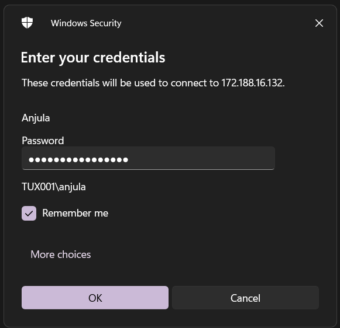

# AD Pentest Lab

## Active Directory lab creation - Initial steps

### Creating Azure resources

- Resource group : ADLab
- VNet : ADLabNet / default range : 10.0.1.0/24

### Domain controller VM

- VM name : GOTHAM-DC
- Image : Windows Server 2019 Datacenter
- Username : anjula
- Password : labuser123Anjula
- Vnet : ADLabNet (10.0.1.0/24)
- Connection : RDP (3389)

### User machine 1

- VM name : THEBATMAN
- Image : Windows 10 Enterprise
- Username : bwayne
- Password : myPassword01
- Vnet : ADLabNet (10.0.1.0/24)
- Connection : RDP (3389)

### User machine 2

- VM name : WAYNEENT
- Image : Windows 10 Enterprise
- Username : lfox
- Password : myPassword02
- Vnet : ADLabNet (10.0.1.0/24)
- Connection : RDP (3389)

---

RDP into GOTHAM-DC with Username : anjula & Password : labuser123Anjula



### Configuring services

Launch Server manager > Add roles and features > Add roles and features wizard

- Server Roles : Active Directory Domain Service

Install service.

Choose “Promote this server to a domain controller”.

### Promoting VM to domain controller

Active directory domain service configuration wizard > Deployment configuration > Add a new forest

- Root domain name : GOTHAM.local
- Forest function level : Windows Server 2016
- Domain function level : Windows Server 2016
- Password : labuser123Anjula


Reboot machine.

RDP into GOTHAM-DC with domain credentials; Username : GOTHAM\anjula & Password : labuser123Anjula


### Configuring certificate services

Launch Server manager > Add roles and features > Add roles and features wizard

- Server roles : Active Directory Certificate Services

Install service.

Choose “Configure Active Directory certificate services on the destination server”.


AD CS configuration wizard >

- Credentials : GOTHAM\anjula
- Role services : Certification Authority
- Setup type : Enterprise CA
- CA type : Root CA
- Private key > Validity period : 99 years


Configure and reboot machine.

---

### Setting up a share

This PC > C:\ Drive > Create new folder “hackme”

Launch Server manager > File and storage services > Shares > Tasks > New share wizard >

- File share profile : SMB Share - Quick
- Share location > custom path : C:\hackme
- Share name : hackme


Create and close.

---

### Creating domain users

Launch Server manager > Tools > Active Directory users and computers > MARVEL.local

Create new Organizational unit (OU) “Groups”

Move every entry except “Guest” and “anjula” from Users to Groups


MARVEL.local > Users >

Create new user

- First name : Bruce
- Last name : Wayne
- User login name : bwayne
- Password : Password1
- Check “Password never expires”

Create another user

- First name : Lucious
- Last name : Fox
- User login name : lfox
- Password : Password2
- Check “Password never expires”


Copy user “anjula” to create another user

- First name : SQL
- Last name : Service
- User login name : SQLService
- Password : MYpassword123#

SQLService > properties >

- Description : “Password is MYpassword123#”


---

### Setting up SPNs

Launch Command prompt as administrator.

Setup SPN for SQLService account

```bash
**setspn -a GOTHAM-DC/SQLService.GOTHAM.local:60111 GOTHAM\SQLService**
```

Confirm SPN.

```bash
**setspn -T GOTHAM.local -Q */***
```


### **Domain machine IP address**

```bash
**ipconfig**
```

- **IP : 10.0.1.4/24**

---

### Connecting to user machines

RDP into THEBATMAN with Username : bwayne and Password : myPassword01

Launch File explorer > Network

Turn on Network discovery.

Launch Settings > Network & internet > Ethernet > Change adapter settings

Choose Ethernet > properties > Internet Protocol version 4 (TCP/IPv4)

- Preferred DNS server : 10.0.1.4


RDP connection will be lost. Reconnect to the same user “bwayne”

Launch Settings > Accounts > Access work or school > Connect

Choose “Join this device to a local Active Directory domain”.

- Domain name : GOTHAM.local

Join a domain >

- User : anjula
- Password : labuser123Anjula


Restart machine.

RDP into WAYNEENT with Username : lfox and Password : myPassword02

Repeat the same process above.

### Configuring Domain users to user machines

Launch GOTHAM-DC > Server manager > Tools > Active Directory users and computers > MARVEL.local > Computers

Both user computers “THEBATMAN” and “WAYNEENT” is listed under the domain.


RDP into THEBATMAN with admin credentials; Username : GOTHAM\anjula and Password : labuser123Anjula

Go to Computer management > Local users and groups > Groups > Administrators.

Choose “Add”

Select Users, computers, service accounts or groups >

- Enter object names to select : bwayne

Check names, then apply.


RDP into WAYNEENT with admin credentials; Username : GOTHAM\anjula and Password : labuser123Anjula

Go to Computer management > Local users and groups > Groups > Administrators.

Choose “Add”

Select Users, computers, service accounts or groups >

- Enter object names to select : lfox

Check names & choose “Add” again

- Enter object names to select : bwayne

Check names, then apply.


---

### Re-connecting to machines with Domain user accounts

RDP into THEBATMAN machine with;

- Username : GOTHAM\bwayne
- Password : Password1

RDP into WAYNEENT machine with both;

- Username : GOTHAM\bwayne
- Password : Password1

and

- Username : GOTHAM\lfox
- Password : Password2

---

## Setting up the Attacker machine - steps

to be continued…
